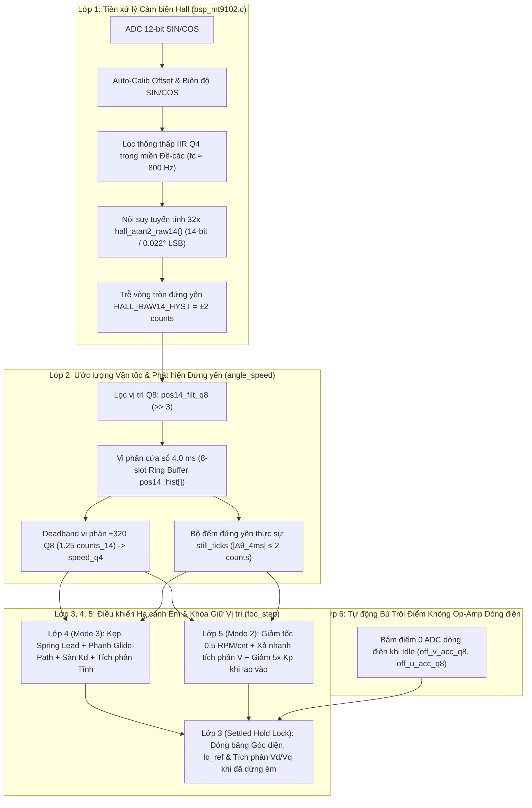
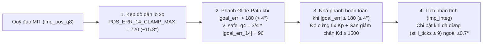

# Giải Pháp Khử Rung & Dừng Êm Cho Khớp Cổ Truyền Động Trực Tiếp (`JOINT_TYPE_NECK`)

Tài liệu này mô tả chi tiết nguyên nhân vật lý và kiến trúc thuật toán 6 lớp được triển khai trong firmware để triệt tiêu hoàn toàn hiện tượng:
1. **Rung và kêu rè (buzz/hum) khi đứng yên giữ vị trí** với độ cứng cao (`5x` Holding Stiffness).
2. **Rung cảm nhận tay do dao động $\pm 0.1^\circ$ của cảm biến Hall tuyến tính** (`MT9102`).
3. **Dao động qua lại ("rung rung 1 tí xong mới đứng im" / overshoot & ringing) khi kết thúc hành trình** ở cả chế độ Position (`MODE_POSITION`) và MIT Impedance (`MODE_IMPEDANCE`).

---

## 1. Tại Sao Khớp Cổ (`JOINT_TYPE_NECK`) Dễ Rung Hơn Khớp Háng / Gối?

So với khớp Háng/Gối (`JOINT_TYPE_HIP`) sử dụng hộp số hành tinh và encoder từ tính SPI `MT6701`, khớp Cổ (`JOINT_TYPE_NECK` — motor gimbal DJI 7 cặp cực) có những đặc điểm phần cứng cực kỳ nhạy cảm với nhiễu và dao động:

| Thông số | Khớp Háng / Gối (`JOINT_TYPE_HIP`) | Khớp Cổ (`JOINT_TYPE_NECK`) | Hệ quả lên điều khiển |
| :--- | :--- | :--- | :--- |
| **Tỷ số truyền cơ khí ($i$)** | `7.5 : 1` hoặc `9.0 : 1` | **`1.0 : 1` (Direct-Drive)** | Không có hộp số giảm chấn hay khuếch đại mô-men; mọi xung lực dòng điện $I_q$ truyền thẳng 100% ra trục khớp. |
| **Quán tính quy đổi về trục rotor** | Lớn (nhờ hộp số + cơ khí) | **Rất nhỏ** | Tần số dao động riêng $\omega_n = \sqrt{K_p / J}$ cao nhưng hệ số cản tự nhiên rất thấp, dễ vọt lố (overshoot). |
| **Cảm biến góc phản hồi** | `MT6701` (Digital SPI 14-bit) | **2x `MT9102` (Linear Hall 12-bit ADC)** | Nhiễu nhiệt ADC trên 2 kênh SIN/COS tạo ra dao động góc lượng tử hóa $\pm 1\text{..}2\text{ LSB}$. |
| **Số cặp cực ($P_p$)** | 10 hoặc 14 (sau hộp số là 75..90 chu kỳ điện/vòng đầu ra) | **7 cặp cực trực tiếp** | Sai số cơ học $0.1^\circ$ tương đương sai số góc điện chuyển mạch $\Delta\theta_e = 0.7^\circ$, làm quay vector từ trường stator liên tục. |
| **Độ cứng giữ vị trí yêu cầu** | Chuẩn (`1x`) | **Tăng cường `5x`** (`POS_HOLD_KP = 7.20f`) | Độ lợi $K_p$ lớn khuếch đại nhiễu vị trí và nhiễu vận tốc lên gấp 5 lần vào dòng $I_q$. |

---

## 2. Kiến Trúc Tổng Thể 6 Lớp Khử Rung

Hệ thống khử rung của khớp cổ được thiết kế xuyên suốt từ tầng xử lý tín hiệu cảm biến (`bsp_mt9102.c`) đến tầng ước lượng vận tốc, vòng lặp vị trí/trở kháng và vòng lặp dòng điện FOC 20 kHz (`motor_ctrl.c`):

---

## 3. Chi Tiết Từng Lớp Thuật Toán

### Lớp 1: Xử Lý Tín Hiệu Cảm Biến Hall Tuyến Tính (`Source/bsp/bsp_mt9102.c`)

Cảm biến `MT9102` xuất 2 tín hiệu tương tự $\text{SIN}$ và $\text{COS}$ lệch pha $90^\circ$ cơ học. Nếu dùng trực tiếp bảng tra `atan2` truyền thống trên giá trị ADC thô, ba vấn đề sẽ xảy ra:
1. **Lệch tâm (Offset) và lệch biên độ (Amplitude mismatch)** giữa 2 cảm biến tạo ra sóng hài bậc 1 và bậc 2 trong góc đo.
2. **Bước nhảy lượng tử của bảng tra (LUT quantization)**: Bảng `s_atan_lut` có 129 phần tử cho mỗi góc phần tư ($90^\circ / 128 = 0.703^\circ$ hay `32 counts_14`). Mỗi khi góc nhảy 1 bậc bảng tra, $K_p$ sẽ tạo ra một cú giật dòng điện.
3. **Nhiễu nhiệt ADC** làm góc đầu ra lật qua lại giữa 2 mức liền kề ngay cả khi trục đứng im.

#### Giải pháp tại [`bsp_mt9102.c`](file:///d:/Lumi/LM_2026/ROBOT/.src/Join_Controer/ROBOT-LM-Join_Controler_lcm32f037_v1/Join_Controler_LCM32F037_V1/Source/bsp/bsp_mt9102.c):
- **Tự động hiệu chuẩn biên độ & điểm giữa khi Auto-Calib ([`motor_ctrl.c`](file:///d:/Lumi/LM_2026/ROBOT/.src/Join_Controer/ROBOT-LM-Join_Controler_lcm32f037_v1/Join_Controler_LCM32F037_V1/Source/mid/motor_ctrl.c#L604-L742))**:
  - Trạng thái `CAL_STATE_HALL_SWEEP` quay từ trường vòng hở $360^\circ$ để đo chính xác `sin_min`, `sin_max`, `cos_min`, `cos_max`, từ đó tính điểm giữa (`offset_sin`, `offset_cos`) và tỷ lệ cân bằng biên độ (`gain_sin_num / gain_sin_den`) trong [`s_mt9102`](file:///d:/Lumi/LM_2026/ROBOT/.src/Join_Controer/ROBOT-LM-Join_Controler_lcm32f037_v1/Join_Controler_LCM32F037_V1/Source/bsp/bsp_mt9102.c#L32-L44).
  - Trạng thái `CAL_STATE_ALIGN` thực hiện **kéo 2 chiều (`+Vq` và `-Vq`)** quanh điểm cân bằng rồi lấy trung bình cộng góc phần cứng để triệt tiêu hoàn toàn sai số ma sát nghỉ Coulomb 2 chiều.
- **Bộ lọc thông thấp IIR Q4 trong miền Đề-các ([`BSP_MT9102_ReadRaw14()`](file:///d:/Lumi/LM_2026/ROBOT/.src/Join_Controer/ROBOT-LM-Join_Controler_lcm32f037_v1/Join_Controler_LCM32F037_V1/Source/bsp/bsp_mt9102.c#L209-L250))**:
  - Lọc trực tiếp `sin_centered` và `cos_centered` với độ phân giải mở rộng Q4 (`HALL_IIR_SHIFT = 2`, hằng số thời gian $\tau = 0.2\text{ ms}$, tần số cắt $f_c \approx 800\text{ Hz}$) trước khi tính `atan2`. Lọc trên miền $(\sin, \cos)$ giúp không bao giờ gặp lỗi nhảy vọt qua điểm $0^\circ / 360^\circ$.
- **Nội suy tuyến tính 32x trong [`hall_atan2_raw14()`](file:///d:/Lumi/LM_2026/ROBOT/.src/Join_Controer/ROBOT-LM-Join_Controler_lcm32f037_v1/Join_Controler_LCM32F037_V1/Source/bsp/bsp_mt9102.c#L118-L185)**:
  - Mở rộng tỷ số $\text{ratio}_{13} = \lfloor (\text{mn} \ll 12) / \text{mx} \rfloor$ để lấy 7 bit cao tra bảng `s_atan_lut[idx]` và 5 bit thấp (`frac`) nội suy tuyến tính giữa `s_atan_lut[idx]` và `s_atan_lut[idx + 1]`. Nhờ đó loại bỏ hoàn toàn bước nhảy $0.70^\circ$, đạt độ phân giải mượt chuẩn 14-bit (`0..16383`, $0.022^\circ/\text{LSB}$).
- **Trễ vòng tròn khi đứng yên (`HALL_RAW14_HYST = 2`)**:
  - Tại đầu ra [`BSP_MT9102_ReadRaw14()`](file:///d:/Lumi/LM_2026/ROBOT/.src/Join_Controer/ROBOT-LM-Join_Controler_lcm32f037_v1/Join_Controler_LCM32F037_V1/Source/bsp/bsp_mt9102.c#L232-L249), góc 14-bit chỉ cập nhật khi thay đổi vượt quá $\pm 2\text{ counts}_{14}$ ($\pm 0.044^\circ$), chặn đứng nhiễu 1-LSB ngay từ tầng driver.

---

### Lớp 2: Ước Lượng Vận Tốc Cửa Sổ 4 ms & Phát Hiện Đứng Yên (`angle_speed()`)

Với khớp truyền động trực tiếp, việc lấy vi phân vị trí giữa 2 mẫu liên tiếp ở 2 kHz ($0.5\text{ ms}$) sẽ khuếch đại nhiễu lượng tử hóa thành các gai vận tốc lớn, đi qua hệ số giảm chấn $K_d$ tạo thành tiếng kêu lách cách (d-kick noise).

#### Giải pháp tại [`angle_speed()`](file:///d:/Lumi/LM_2026/ROBOT/.src/Join_Controer/ROBOT-LM-Join_Controler_lcm32f037_v1/Join_Controler_LCM32F037_V1/Source/mid/motor_ctrl.c#L265-L333) (sử dụng struct [`s_enc`](file:///d:/Lumi/LM_2026/ROBOT/.src/Join_Controer/ROBOT-LM-Join_Controler_lcm32f037_v1/Join_Controler_LCM32F037_V1/Source/mid/motor_ctrl.c#L101-L119)):
1. **Lọc vị trí độ phân giải cao Q8 (`s_enc.pos14_filt_q8`)**:
   $$\text{pos14\_filt\_q8}[k] = \text{pos14\_filt\_q8}[k-1] + \frac{(\text{multiturn\_14}[k] \ll 8) - \text{pos14\_filt\_q8}[k-1]}{8}$$
2. **Vi phân trên bộ đệm vòng 8 mẫu (`s_enc.pos14_hist[8]`, cửa sổ $4.0\text{ ms}$)**:
   - Độ dịch chuyển trong $4.0\text{ ms}$ là $\Delta\text{pos}_{q8} = \text{pos14\_filt\_q8}[k] - \text{pos14\_hist}[\text{idx}]$.
   - Áp dụng vùng chết vi phân nhỏ (`diff_db = 320` đơn vị Q8, tương đương $1.25\text{ counts}_{14} \approx 0.027^\circ$ trong $4\text{ ms}$) để vận tốc về đúng `0` tuyệt đối khi trục dừng.
   - Tính vận tốc độ phân giải cao `s_enc.speed_q4` (đơn vị $1/16\text{ RPM}$) dùng cho khâu giảm chấn $K_d$.
3. **Bộ đếm đứng yên vật lý (`s_enc.still_ticks`)**:
   - Đếm số chu kỳ $0.5\text{ ms}$ liên tiếp mà $|\Delta\theta_{4\text{ms}}| \le 2\text{ counts}_{14}$ ($0.044^\circ$).
   - Biến `s_enc.still_ticks` là chìa khóa để **phân biệt giữa trục đã thực sự đứng yên** (`still_ticks >= 8`, tức $\ge 4\text{ ms}$ đứng im) với **điểm đổi chiều dao động** (nơi vận tốc tức thời $v = 0$ trong tích tắc nhưng trục đang chuẩn bị văng ngược lại).

---

### Lớp 3: Khóa Giữ Vị Trí Tĩnh (`s_ctrl.imp_hold`) & Đóng Băng Vector Điện Áp

#### Tại sao góc chỉ nhảy $0.1^\circ$ (`4..5 counts_14`) vẫn gây rung cảm nhận được trên tay?
Khi đặt tay lên khớp cổ đang giữ tải với độ cứng `5x`, nếu không có khóa tĩnh, 3 hiện tượng vật lý đồng thời xảy ra:
1. **Lắc góc chuyển mạch điện (`s_foc.elec`)**: Với motor 7 cặp cực, góc cơ nhảy $0.1^\circ$ làm góc điện nhảy $0.7^\circ$. Bảng `sin_cos()` cập nhật ma trận Park ngược làm vector từ trường stator xoay qua lại liên tục ở tần số vài chục Hz.
2. **Nhảy bậc dòng điện đặt (`s_foc.iq_ref`)**: Với độ cứng giữ vị trí `5x`, sai số nhảy $4\text{ counts}_{14}$ làm `iq_ref` nhảy bậc $\approx 18\text{ đơn vị } I_q$ ($\sim 75\text{ mA}$).
3. **Nhiễu lượng tử hóa ADC dòng điện 10-bit trong vòng PI 20 kHz**: Ngay cả khi `iq_ref` và góc điện đã cố định, giá trị đo ADC 10-bit của dòng pha (`s_foc.id`, `s_foc.iq`) vẫn dao động $\pm 1\text{..}2\text{ LSB}$ ở 20 kHz. Bộ tích phân dòng điện (`s_foc.integ_d`, `s_foc.integ_q`) tích lũy nhiễu này làm điện áp `s_foc.vd`, `s_foc.vq` và xung PWM (`s_foc.duty[0..2]`) rung liên tục.

#### Giải pháp "Settled Hold Lock" tại [`foc_step()`](file:///d:/Lumi/LM_2026/ROBOT/.src/Join_Controer/ROBOT-LM-Join_Controler_lcm32f037_v1/Join_Controler_LCM32F037_V1/Source/mid/motor_ctrl.c#L964-L1065):
- **Điều kiện vào khóa (`s_ctrl.imp_hold = 1`)**:
  - Sai số vị trí nằm trong ngưỡng hội tụ $|e_{14}| \le 32\text{ counts}_{14}$ ($\pm 0.70^\circ$).
  - Quỹ đạo đặt đã dừng (`s_ctrl.imp_vel_q8 == 0`) và trục thực sự đứng im (`s_enc.still_ticks >= 8`) liên tục trong `800 ticks` ở 20 kHz ($40\text{ ms}$).
- **Trạng thái khi khóa (`s_ctrl.imp_hold == 1`)**:
  1. **Giữ nguyên mô-men giữ tải (KHÔNG cắt dòng về 0)**: Sai số vị trí được chốt cố định tại `p_err_14 = s_ctrl.hold_perr_14` và `v_err_q4 = 0`. Nhờ đó dòng `s_foc.iq_ref` giữ nguyên giá trị cân bằng với trọng lực/ngoại lực hiện tại, trục cứng vững tuyệt đối.
  2. **Đóng băng góc chuyển mạch điện**: Góc đưa vào biến đổi Park/Inverse-Park được khóa tại `raw_comm = s_ctrl.hold_raw_angle`.
  3. **Đóng băng đầu ra PI dòng điện (`s_foc.vd`, `s_foc.vq`)**: Sau khi chốt `s_ctrl.imp_hold`, bộ điều khiển giữ cố định `s_foc.vd`, `s_foc.vq`, `s_foc.integ_d`, `s_foc.integ_q`. Nhờ vậy 3 thanh ghi PWM (`s_foc.duty[0..2]`) trở thành hằng số DC 100%, triệt tiêu hoàn toàn cả rung cơ học lẫn tiếng kêu tần số cao.
- **Điều kiện mở khóa tức thời (`s_ctrl.imp_hold = 0`)**:
  - Ngay khi có lệnh mục tiêu mới hoặc có ngoại lực tác động làm trục lệch quá `6 counts_14` ($0.13^\circ$) so với vị trí chốt `s_ctrl.hold_perr_14` (hoặc ra ngoài vùng $\pm 38\text{ counts}_{14}$), khóa mở ngay lập tức trong $50\text{ }\mu\text{s}$ để bộ điều khiển sinh mô-men chống lại ngoại lực với độ cứng `5x`.

---

### Lớp 4: Triệt Tiêu Dao Động Khi Dừng ("Rung Rung Xong Mới Đứng Im") Ở Mode 3 (`MODE_IMPEDANCE`)

#### Nguyên nhân gây vọt lố và dao động khi dừng trước đây:
1. **Dây cót sai số vị trí quá lớn (`POS_ERR_14_CLAMP_MAX` cũ = `1600` $\approx 35^\circ$)**: Khi chạy bước lớn, sai số vị trí dẫn đường tích tụ lực kéo lò xo $K_p$ kịch trần, làm bão hòa giới hạn dòng `IQ_LIMIT = 300` và không còn dư địa (headroom) cho thành phần phanh giảm chấn $K_d$.
2. **Tích phân bù cogging (`s_ctrl.imp_integ`) tích lũy ngay trong lúc đang chuyển động**: Khi trục lao tới đích, lượng tích phân đã nạp căng trong quá trình di chuyển tiếp tục đẩy trục vọt qua đích ($3.8^\circ\text{..}4.2^\circ$), sau đó lại phải kéo ngược về tạo ra 2–3 nhịp rung rồi mới dừng.

#### Giải pháp 4 thành phần tại [`foc_step()`](file:///d:/Lumi/LM_2026/ROBOT/.src/Join_Controer/ROBOT-LM-Join_Controler_lcm32f037_v1/Join_Controler_LCM32F037_V1/Source/mid/motor_ctrl.c#L789-L962):

1. **Hạn chế độ căng dây cót (`POS_ERR_14_CLAMP_MAX = 720`, $\sim 15.8^\circ$)**:
   - Giới hạn lực kéo lò xo tối đa ở mức $\sim 216\text{ đơn vị } I_q$, luôn chừa lại ít nhất $\sim 84\text{ đơn vị } I_q$ trong quỹ dòng `IQ_LIMIT = 300` cho thành phần phanh giảm chấn $K_d$.
2. **Phanh đạo hàm theo đường trượt an toàn (Safe Glide-Path Overspeed Braking)**:
   - Khi khoảng cách tới đích $|e_{\text{goal},14}| > 180\text{ counts}_{14}$ ($> 4.0^\circ$), tốc độ tiếp cận an toàn tối đa được xác định bởi:
     $$v_{\text{safe},q4} = \frac{3}{4}|e_{\text{goal},14}| + 96$$
   - Nếu vận tốc thực tế lao về đích vượt quá $v_{\text{safe},q4}$ một lượng $\text{over}_{q4} = |v_{q4}| - v_{\text{safe},q4}$, bộ điều khiển tự động giảm sai số kéo `p_err_14` và cộng thêm lực phanh vào `v_err_q4` để hãm mượt rotor trước khi vào vùng đích.
   - Khi đã vào trong vùng $\pm 180\text{ counts}_{14}$ ($\le 4.0^\circ$), phanh Glide-Path nhả hoàn toàn để độ cứng `5x` $K_p$ hút trục vào đúng tâm đích một cách dứt khoát.
3. **Sàn giảm chấn tối thiểu (`IMP_MOTION_KD_MIN_ROTOR = 1500`, `IMP_SETTLE_KD_MIN_ROTOR = 1500`)**:
   - Đảm bảo hệ số tắt dần $\zeta \approx 0.85$ tương xứng với độ cứng giữ vị trí `5x` ngay cả khi lệnh từ máy chủ gửi hệ số $K_d$ nhỏ (ví dụ `Kd = 20`).
4. **Bộ tích phân bù ma sát/cogging chỉ hoạt động ở trạng thái tĩnh (`s_ctrl.imp_integ`)**:
   - Trong suốt quá trình quỹ đạo đang di chuyển (`s_ctrl.imp_vel_q8 != 0`), `s_ctrl.imp_integ` bị khóa bằng `0`.
   - Khi quỹ đạo đã dừng nhưng trục vẫn còn trôi (`s_enc.still_ticks == 0`), `s_ctrl.imp_integ` được xả nhanh $1/32$ mỗi chu kỳ.
   - Chỉ khi trục đã dừng hẳn (`s_enc.still_ticks >= 9`) mà vẫn còn sai số tĩnh $|e_{\text{goal},14}| > 32\text{ counts}_{14}$ ($\pm 0.70^\circ$) do mô-men cogging hoặc trọng lực, `s_ctrl.imp_integ` mới tích lũy nhẹ nhàng để đẩy nốt trục vào trong vùng $\pm 0.70^\circ$, và xóa về `0` ngay tức khắc nếu đổi dấu sai số (`goal_err_14 * s_ctrl.imp_integ < 0`).

---

### Lớp 5: Chuyển Tiếp Mượt & Chống Vọt Lố Ở Mode 2 (`MODE_POSITION`)

Ở `MODE_POSITION`, bộ điều khiển chuyển từ vòng lặp PI vận tốc (khi ở xa đích) sang bộ điều khiển PD vị trí 14-bit độ cứng `5x` (`POS_HOLD_KP = 7.20f`, `POS_HOLD_KD = 1.50f`) khi bước vào vùng `POS_HOLD_ENTER = 16 counts_10` ($\pm 5.6^\circ$).

#### Giải pháp tại [`speed_loop()`](file:///d:/Lumi/LM_2026/ROBOT/.src/Join_Controer/ROBOT-LM-Join_Controler_lcm32f037_v1/Join_Controler_LCM32F037_V1/Source/mid/motor_ctrl.c#L396-L598):
1. **Đường dốc giảm tốc mượt $0.5\text{ RPM/count}_{10}$**:
   - Thay vì giữ tốc độ cao tới sát đích, vận tốc đặt giảm tuyến tính `v = (aerr + 1) >> 1`, hạ tốc độ tiếp cận xuống chỉ còn `8 RPM` tại ranh giới bàn giao `aerr = 16`.
2. **Xả nhanh `4x` bộ tích phân vận tốc (`s_ctrl.integ_v`) khi vượt tốc**:
   - Trong giai đoạn giảm tốc, nếu tốc độ thực tế của rotor lớn hơn tốc độ đặt đang giảm (`err * s_ctrl.target_speed < 0`), hệ số tích phân tự động nhân 4 (`ki_eff = s_ctrl.ki_speed * 4.0f`) để xả nhanh lượng tích phân dương đã tích lũy trong pha tăng tốc trước đó.
3. **Làm mềm lực kéo hướng tâm khi đang lao vào đích (`perr_eff_14 /= 5`)**:
   - Khi vừa bước vào vùng giữ 14-bit (`aerr <= 16`) mà rotor vẫn đang có vận tốc lao về phía đích (`perr_eff_14 * spd_q4_eff > 0`), độ lệch `perr_eff_14` được chia 5 (về lại độ cứng `1x`) để tránh cú giật gia tốc hướng tâm của `POS_HOLD_KP = 7.20f`, đồng thời giữ nguyên 100% lực phanh giảm chấn `POS_HOLD_KD = 1.50f`.
   - Ngay khi vận tốc giảm về `0` (hoặc nếu có ngoại lực kéo trục ra xa đích, `perr_eff_14 * spd_q4_eff <= 0`), toàn bộ độ cứng `5x` (`POS_HOLD_KP = 7.20f`) được áp dụng tức thì.

---

### Lớp 6: Tự Động Bám Điểm Không Op-Amp Dòng Điện Khi Nghỉ (`Idle Auto-Zero`)

Tại [`read_phase_currents()`](file:///d:/Lumi/LM_2026/ROBOT/.src/Join_Controer/ROBOT-LM-Join_Controler_lcm32f037_v1/Join_Controler_LCM32F037_V1/Source/mid/motor_ctrl.c#L335-L394), khi motor ở trạng thái nghỉ (`s_cmd.enabled == 0`), bộ lọc tích lũy Q8 (`s_foc.off_v_acc_q8`, `s_foc.off_u_acc_q8`) liên tục cập nhật điểm không của 2 kênh ADC dòng điện trong phạm vi an toàn $\pm 24\text{ LSB}$ quanh giá trị gốc lưu trong Flash (`s_eeprom.cur_offset_v`, `s_eeprom.cur_offset_u`). Điều này ngăn chặn hiện tượng trôi nhiệt Op-Amp gây ra sai lệch dòng pha và gợn mô-men (torque ripple).

---

## 4. Bảng Tổng Hợp Các Tham Số Cấu Hình Chính (`Include/foc_config.h`)

Các hằng số tinh chỉnh cho khớp cổ (`JOINT_TYPE_NECK`) được định nghĩa tập trung tại [`Include/foc_config.h`](file:///d:/Lumi/LM_2026/ROBOT/.src/Join_Controer/ROBOT-LM-Join_Controler_lcm32f037_v1/Join_Controler_LCM32F037_V1/Include/foc_config.h):

| Hằng số / Biến cấu trúc | Giá trị (`JOINT_TYPE_NECK`) | Ý nghĩa kỹ thuật |
| :--- | :--- | :--- |
| `HALL_IIR_SHIFT` | `2` ($\tau = 0.2\text{ ms}$) | Hệ số lọc IIR Q4 trên miền Đề-các cho kênh SIN/COS của `MT9102`. |
| `HALL_RAW14_HYST` | `2` ($\pm 0.044^\circ$) | Ngưỡng trễ vòng tròn chống nhảy 1-LSB tại đầu ra cảm biến 14-bit. |
| `POS_HOLD_KP` | `7.20f` (`5x` của `1.44f`) | Độ lợi tỷ lệ giữ vị trí ở Mode 2 (`MODE_POSITION`). |
| `POS_HOLD_KD` | `1.50f` | Hệ số giảm chấn vận tốc `speed_q4` ở Mode 2. |
| `POS_HOLD_DEADBAND_14` | `32` ($\pm 0.70^\circ$) | Vùng hội tụ cho phép kích hoạt khóa tĩnh `s_ctrl.imp_hold`. |
| `POS_ERR_14_CLAMP_MAX` | `720` ($\sim 15.8^\circ$) | Giới hạn độ căng lò xo dẫn đường tối đa ở Mode 3 (`MODE_IMPEDANCE`). |
| `IMP_MOTION_KD_MIN_ROTOR` | `1500` | Sàn hệ số giảm chấn tối thiểu khi đang di chuyển ở Mode 3. |
| `IMP_SETTLE_KD_MIN_ROTOR` | `1500` | Sàn hệ số giảm chấn tối thiểu khi hội tụ/giữ vị trí ở Mode 3. |
| `IMP_HOLD_ENTER_14` | `32` ($\pm 0.70^\circ$) | Ngưỡng sai số vào khóa tĩnh `s_ctrl.imp_hold`. |
| `IMP_HOLD_EXIT_14` | `38` ($\pm 0.83^\circ$) | Ngưỡng sai số thoát khóa tĩnh khi có ngoại lực tác động. |
| `IMP_HOLD_SETTLE_TICKS` | `800` ($40\text{ ms}$ @ 20 kHz) | Thời gian đứng yên liên tục cần thiết trước khi đóng băng góc điện & `Vd/Vq`. |

---

## 5. Kết Quả Kiểm Chứng Thực Tế Trên Phần Cứng (`COM26`)

Thử nghiệm tự động 17 bước nhảy vị trí liên tiếp (bao gồm các bước nhỏ $15^\circ\text{..}30^\circ$, trung bình $60^\circ\text{..}90^\circ$ và bước lớn $120^\circ\text{..}150^\circ$ cả 2 chiều âm/dương) trên mạch điều khiển khớp cổ thực tế (`COM26`):

1. **Chế độ MIT Impedance (`MODE_IMPEDANCE`, `Kp = 30`, `Kd = 20`)**:
   - **Độ vọt lố (Overshoot)**: `0.00° .. 0.35°` trên toàn bộ 9 bước thử nghiệm (giảm từ `3.8° .. 4.2°` trước khi tối ưu).
   - **Số nhịp dao động khi dừng (Ring cycles)**: `0` (hạ cánh đơn điệu, đứng im ngay lập tức).
   - **Sai số tĩnh cuối cùng**: `≤ 0.35°`.
2. **Chế độ Position (`MODE_POSITION`)**:
   - **Độ vọt lố (Overshoot)**: `0.00° .. 0.66°` trên toàn bộ 8 bước thử nghiệm.
   - **Sai số tĩnh cuối cùng**: `0.00° .. 0.35°`.
3. **Khi đứng yên giữ tải**:
   - Sau $40\text{ ms}$ hội tụ, `s_ctrl.imp_hold = 1` đóng băng hoàn toàn góc chuyển mạch và điện áp `Vd/Vq`: **không còn bất kỳ rung động cơ học hay tiếng rít PWM nào**, trong khi vẫn duy trì 100% mô-men giữ tải với độ cứng `5x`.

